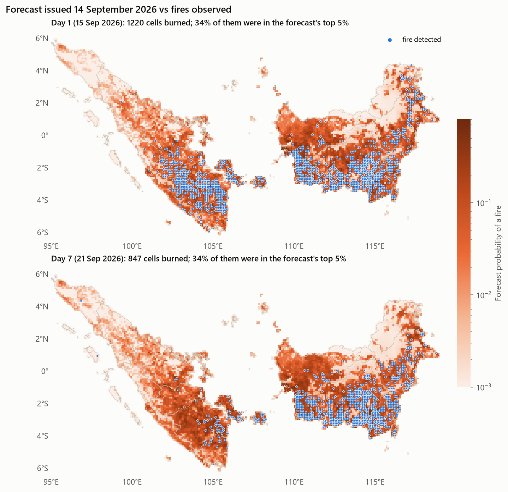
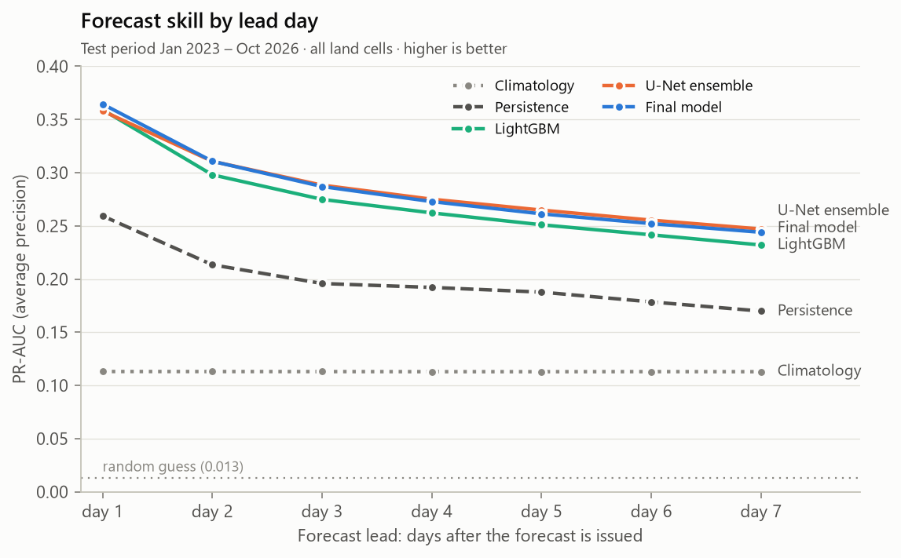
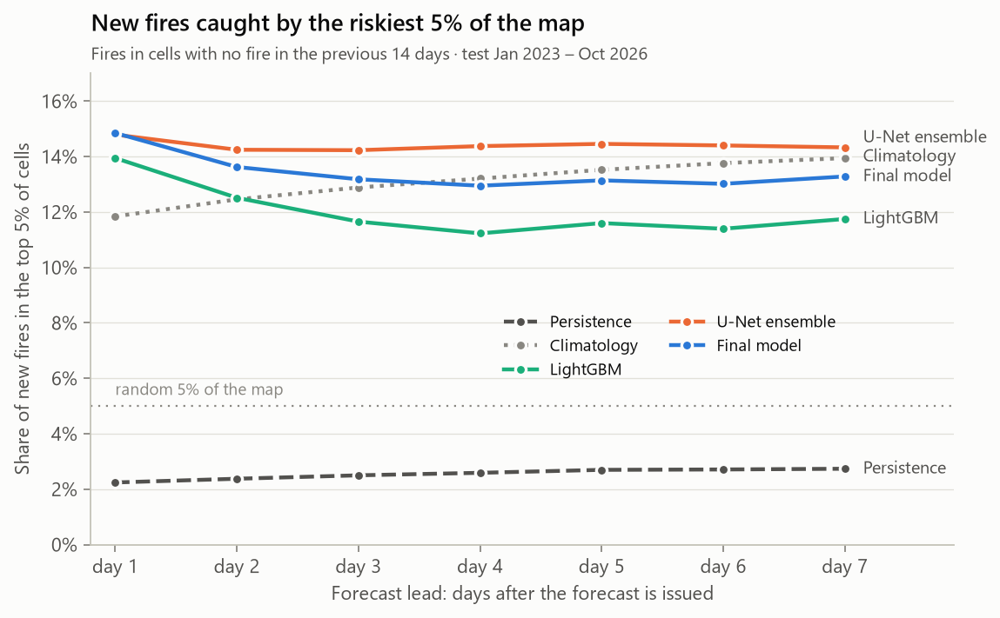

# TitikApi — 7-day wildfire forecasts for Sumatra & Kalimantan

*Titik api* is Indonesian for "hotspot". TitikApi forecasts, for every ~11 km land cell in Sumatra
and Kalimantan, the probability that a fire is detected there on each of the next 7 days, using
public satellite fire detections, weather reanalysis and land-cover maps.

Indonesia's peatland fires cause regional haze crises in El Niño years (2015, 2019, 2023, and
again in 2026). Fire agencies patrol with limited people. The question this project answers is
practical: **if patrols could cover only 5% of the region each day, where should they go?**

> **Status:** model trained and evaluated on 2023 – October 2026 (including the 2026 El Niño
> season). A daily live forecast map (GitHub Actions + Hugging Face + Vercel) is in progress.



## Results

Test period **January 2023 – October 2026**, never used for training, tuning or model choice.
The final model was picked *before* looking at the test set (best validation score, 2021–22).

| Model | PR-AUC, day 1 | PR-AUC, day 7 | Riskiest 5% of the map catches… (day 1) | …new fires, day 1 / day 7 |
|---|---|---|---|---|
| Climatology (cell's historical fire rate for the month) | 0.113 | 0.113 | 25% | 12% / 14% |
| Persistence (carry today's fire state forward) | 0.259 | 0.170 | 37% | 2% / 3% |
| LightGBM, 42 per-cell features | 0.359 | 0.232 | 42% | 14% / 12% |
| U-Net ensemble | 0.358 | **0.247** | 42% | **15% / 14%** |
| **Final model** (U-Net ensemble + LightGBM) | **0.365** | 0.244 | **43%** | **15%** / 13% |

*New fires* are fires in cells with no fire in the previous 14 days; persistence cannot predict them.

**How to read PR-AUC here.** Only 1.3% of land cells burn on a given day, so a random guess scores
0.013. The final model scores **28× random at day 1 and 19× at day 7**. (Its ROC-AUC is 0.93 / 0.91,
but ROC-AUC is flattered by the 98.7% easy no-fire cells, so it isn't the headline.) Even two
satellites carrying the same instrument ~50 minutes apart agree on only 27–52% of fire cell-days
(see below), so no forecast can come close to 1.



### What the experiments showed

1. **Large, consistent gains over the baselines**: ~40% higher PR-AUC than persistence at both
   day 1 and day 7 over the test period, and ahead of persistence in every test year.
2. **Deep learning earns its place at longer leads and on new fires, not at day 1.** LightGBM with
   hand-built neighbourhood features ties the U-Net next-day; from day 2 on the U-Net is ahead, and
   it is the only model that beats climatology on new fires at every lead (LightGBM falls below
   it from day 3). Averaging the two gives the best overall model.
3. **Overfitting fixed, ceiling unchanged.** Random-crop augmentation and stronger regularisation
   stopped the U-Net from overfitting after 5 epochs, but did not raise its best score, and a 4×
   smaller U-Net scores the same. The limit is the information in the inputs, not model size.
4. **New fires a week ahead are only marginally predictable** from weather and fire history
   (U-Net 14.3% vs climatology 13.9%). Most are set by people clearing land.
5. **The probabilities are calibrated** (recalibrated on the validation years), with slight
   under-forecasting at low probabilities in the fire-heavy test years.



### The satellite retired mid-project

The training labels come from VIIRS on **Suomi NPP**, which stopped delivering data on
**2 November 2026**. NOAA-20 carries the same instrument. Over 2019–2025 it sees a similar amount of
fire (1–16% more, by year), but the two agree on only 27–52% of individual fire cell-days.
Re-scoring the trained models with NOAA-20 fire history as input *and* NOAA-20 fires as the target
(2023–25) costs **~5% PR-AUC at day 1 and ~0% at day 7**, so the live system switches to NOAA-20
without retraining (`titikapi sensor-transfer`, `reports/sensor_transfer.csv`).

## How it works

| | |
|---|---|
| **Target** | NASA FIRMS VIIRS 375 m active fires (nominal/high confidence, vegetation fires), on a 0.1° grid, by local solar day |
| **Inputs at issue day *t*** | 14 days of fire history (+ counts, FRP, days since fire) · ERA5 weather at 13:00 WIB and noon-to-noon rain · Canadian Fire Weather Index codes (xclim) · 7–90-day rain memory · peat fraction (PEATMAP) · elevation (Copernicus DEM) · tree cover and *prior-year* forest loss (Hansen GFC) · fire climatology (training years only) · season · ENSO index lagged to what was known at *t* |
| **Models** | Persistence and climatology baselines · LightGBM, one model per lead day · U-Net (GroupNorm, depth 4) predicting 7 lead-day maps at once, weather resampled from 0.25° inside the network · ensembles of calibrated probabilities |
| **Evaluation** | Train 2012–2020 · validate 2021–22 (early stopping, Platt calibration, model choice) · test 2023 – Oct 2026 · PR-AUC, Brier, top-5% coverage, reliability · all metrics also on new ignitions |
| **Leakage guards** | Tests check that inputs at *t* use only data up to *t*, that forest loss only counts years before the issue year, and that climatology uses training days only |
| **Compute** | Data prep on a laptop; training on free Kaggle T4 GPUs (`scripts/kaggle_build.py` uploads the inputs once and runs any command remotely) |

Notebooks: [`01_eda_fire.ipynb`](notebooks/01_eda_fire.ipynb) (what the target looks like) ·
[`02_results.ipynb`](notebooks/02_results.ipynb) (everything above, with per-year results and
calibration).

## Limitations

* **Imperfect labels:** VIIRS misses fires under cloud and between overpasses.
* **August–October 2026** use near-real-time S-NPP data, which has no fire-type flag. Detections
  at locations the science-quality record flags as gas flares or volcanoes were removed.
* **No weather forecasts yet:** inputs stop at the issue day. Adding forecast weather for days
  1–7 is the obvious next experiment.
* **Human ignitions** (land clearing) are not observed by any input.

## Reproduce

```bash
uv sync
uv run titikapi build-static                      # provinces, peat, elevation, forest
uv run titikapi build-fire --end-year 2026 --last-day 2026-10-31   # needs FIRMS_MAP_KEY for 2026
uv run titikapi download-era5                     # needs a Copernicus CDS account (~/.cdsapirc)
uv run titikapi build-weather && uv run titikapi build-arrays
uv run titikapi evaluate-baselines
uv run titikapi train --name unet_reg --epochs 12 --dropout 0.2 --weight-decay 0.05
uv run titikapi evaluate-model --name unet_reg    # likewise for the other runs
uv run titikapi train-lgbm
uv run titikapi evaluate-ensemble --name ens_unet --members unet_reg unet_crop unet_crop16
uv run titikapi evaluate-ensemble --name ens_mix --members ens_unet lgbm
uv run titikapi sensor-transfer                   # S-NPP vs NOAA-20
uv run pytest
```

## Data sources

NASA FIRMS VIIRS active fires (S-NPP, NOAA-20) · ERA5 reanalysis, Copernicus Climate Change
Service · ECMWF open data (CC BY 4.0) · PEATMAP (Xu et al. 2018) · Hansen/UMD/Google/USGS/NASA
Global Forest Change v1.13 (CC BY 4.0) · Copernicus DEM GLO-90 · NOAA CPC Oceanic Niño Index ·
geoBoundaries (CC BY 4.0).
